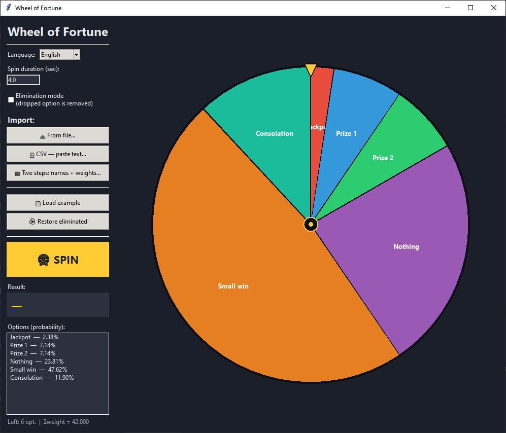

# Колесо Фортуны

Простое колесо фортуны с весами, GUI на `tkinter`, режимом на выбывание и удобным bulk импортом.
Python 3.10+ (проверено на 3.14), сторонних зависимостей нет.



## Запуск

```bash
python main.py
```
Или с uv:
```bash
uv run main.py
```

## Возможности

- Bulk импорт: csv (файл или вставка), варианты и веса в двух диалоговых окнах.
- Варианты с весами.
- Настраиваемое время прокрутки.
- Режим на выбывание.

## Формат импорта

**Файл / CSV-вставка** — одна строка на вариант, разделитель `;` или `,`:

```
Джекпот, 1
Приз 1, 3
Пусто
Мелочь, 20
```

Вес опционален (по умолчанию 1). Строки `#` — комментарии.

**Два шага** — сначала список названий (по одному в строке), затем список весов.
Количество строк обязано совпадать.

## AI Disclosure

Этот код полностью сгенерирован DeepSeek быстренько для личного пользования.
Код в полном беспорядке, я его даже не просматривал, тестировал только в самом приложении, и то не искал никакие эдж кейсы.
Перевод полностью машинный, тоже не просматривал, добавил английский для минимальной международности приложения.
